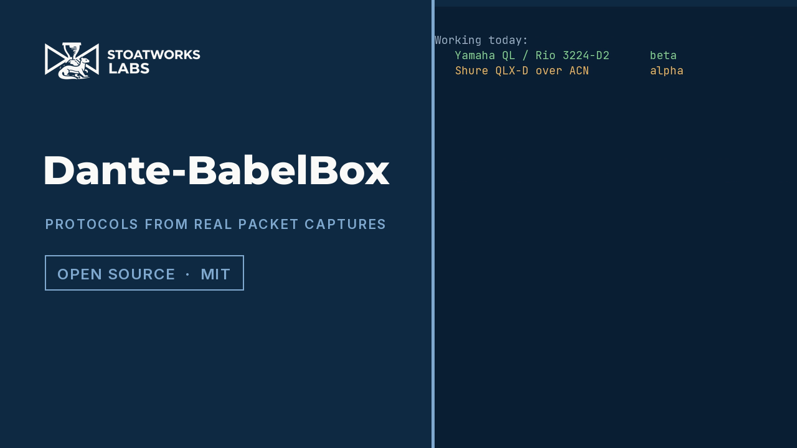
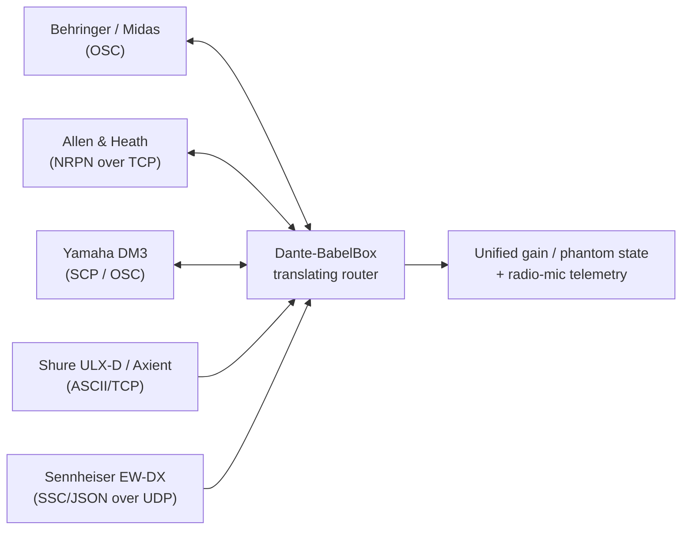
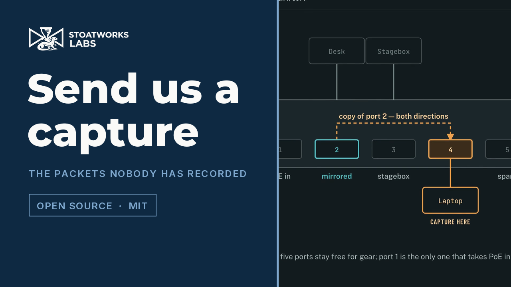
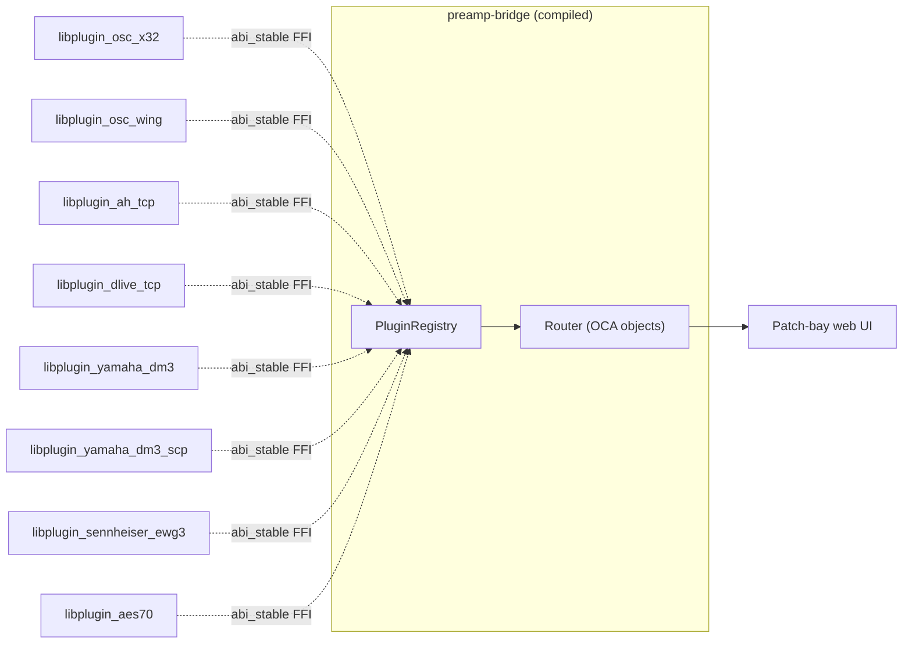
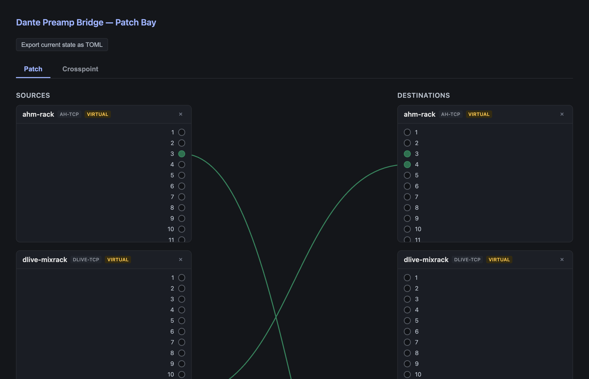

# Dante-BabelBox

> **AI-assisted project.** This codebase was created with [Claude](https://claude.com/claude-code)
> (Anthropic), directed and reviewed by a human author. Most adapters are built against official
> or community-authoritative vendor protocol specs or a published standard (each adapter's module
> doc comment names its source). The rest are flagged where they appear: the Yamaha R-series
> (`MBC`), Sennheiser G3 (WSM), Shure QLX-D (ACN) and Allen & Heath DT work is reverse-engineered,
> and the Lectrosonics mic adapter's wire format is an unverified placeholder (see the Radio Mic
> Telemetry status table). Almost every adapter here has only been tested against mock devices
> and is **not validated against real hardware**, so check it over before you use it on live
> gear. There are three exceptions.
>
> **First, the Yamaha DM3 is fully validated on hardware.** On 2026-09-15, the **SCP adapter**
> (`Dm3ScpAdapter`, kind `yamaha-dm3-scp`, TCP 49280) had every path proven on a real DM3
> (firmware V3.00) through the full plugin stack: `preamp-bridge` loaded the `cdylib`, connected
> to the desk, identified it, read and wrote gain and phantom, and turned the desk's own `NOTIFY`
> push into a live `subscribe()` change feed. It's the first adapter here with every method
> proven on hardware rather than just against mocks. The older OSC adapter (`Dm3Adapter`, kind
> `yamaha-dm3`) ran on the desk too but is weaker, for reasons the status table gives, and that's
> why SCP got built. Full findings:
> [`docs/yamaha-dm3-bench-2026-09-15.md`](docs/yamaha-dm3-bench-2026-09-15.md).
>
> **Second, the Sennheiser G3.** The same day, the `sennheiser-ewg3` adapter drove a real EM 500
> G3's AF-out level from the DM3's remote head-amp gain, through the bridge, end to end. Its
> protocol is reverse-engineered from Wireless Systems Manager, and WSM has to be closed first,
> since it holds the receiver's only write slot. Full findings:
> [`docs/sennheiser-ewg3-bench-2026-09-15.md`](docs/sennheiser-ewg3-bench-2026-09-15.md).
>
> **Third, and it's a big one.** The Yamaha R-series HA protocol was captured from a real QL1 +
> Rio3224-D2, decoded, written up, then **rebuilt from the write-up and sent back, and the
> stagebox accepted it and changed its gain** (see
> [`docs/yamaha-ha-remote-over-dante.md`](docs/yamaha-ha-remote-over-dante.md)). What that proves
> on hardware is the protocol. The adapter now exists (`MbcAdapter`) and its codec reproduces the
> frame the Rio accepted byte for byte, but the adapter itself has still never been run against a
> real device. The wire format is verified; the code around it is tested against captured frames,
> like everything else here.

A control bridge for Dante rigs with kit from more than one manufacturer. It does two jobs:

1. **Preamp control.** Gain and phantom power, bridged across Dante-networked mixing consoles
   and stageboxes from different vendors.
2. **Radio-mic telemetry.** Battery, RF signal and audio level from wireless mic receivers,
   across vendors, whether or not the receiver even has a Dante audio option fitted (the "Radio
   Mic Telemetry" sections below explain why that doesn't matter here).

[](https://www.youtube.com/watch?v=Tx7hntcaOTw)

*56 seconds. Every line of terminal output is the actual decoder: the two capture-replay tools in
this repo, run against recordings of a real Yamaha QL1 talking to a Rio3224-D2 and a Shure QLXD4
mounted on a console.*

Dante carries your audio and a basic mDNS-based device discovery, and there it stops. Preamp
gain, phantom power and wireless-mic status are left to each manufacturer, and each one runs its
own proprietary control protocol over the same network. So one cable ends up carrying several
languages that don't understand each other, hence the name. This project translates between
them, so the state of one vendor's device can be used from outside that vendor's own kit.



<!-- downloads:start -->

## Download

**[v0.5.0](https://github.com/stoatworks-labs/Dante-BabelBox/releases/tag/v0.5.0)** — prebuilt for macOS, Windows and Linux. Pick your platform:

<details>
<summary><b>macOS</b> — Universal (Apple Silicon + Intel)</summary>

| Build | Download | Size |
| --- | --- | --- |
| Universal (Apple Silicon + Intel) · .tar.gz archive | [`dante-babelbox-macos-universal.tar.gz`](https://github.com/stoatworks-labs/Dante-BabelBox/releases/latest/download/dante-babelbox-macos-universal.tar.gz) | 9.4 MB |

</details>

<details>
<summary><b>Windows</b> — x64, ARM64</summary>

| Build | Download | Size |
| --- | --- | --- |
| x64 · .zip archive | [`dante-babelbox-windows-x86_64.zip`](https://github.com/stoatworks-labs/Dante-BabelBox/releases/latest/download/dante-babelbox-windows-x86_64.zip) | 4.1 MB |
| ARM64 · .zip archive | [`dante-babelbox-windows-aarch64.zip`](https://github.com/stoatworks-labs/Dante-BabelBox/releases/latest/download/dante-babelbox-windows-aarch64.zip) | 3.9 MB |

</details>

<details>
<summary><b>Linux</b> — x64, ARM64</summary>

| Build | Download | Size |
| --- | --- | --- |
| x64 · .deb package (Debian/Ubuntu) | [`dante-babelbox_0.5.0_amd64.deb`](https://github.com/stoatworks-labs/Dante-BabelBox/releases/download/v0.5.0/dante-babelbox_0.5.0_amd64.deb) | 5.2 MB |
| ARM64 · .deb package (Debian/Ubuntu) | [`dante-babelbox_0.5.0_arm64.deb`](https://github.com/stoatworks-labs/Dante-BabelBox/releases/download/v0.5.0/dante-babelbox_0.5.0_arm64.deb) | 5.2 MB |
| x64 · .rpm package (Fedora/RHEL) | [`dante-babelbox-0.5.0-1.x86_64.rpm`](https://github.com/stoatworks-labs/Dante-BabelBox/releases/download/v0.5.0/dante-babelbox-0.5.0-1.x86_64.rpm) | 5.4 MB |
| ARM64 · .rpm package (Fedora/RHEL) | [`dante-babelbox-0.5.0-1.aarch64.rpm`](https://github.com/stoatworks-labs/Dante-BabelBox/releases/download/v0.5.0/dante-babelbox-0.5.0-1.aarch64.rpm) | 5.4 MB |
| x64 · .tar.gz archive | [`dante-babelbox-linux-x86_64.tar.gz`](https://github.com/stoatworks-labs/Dante-BabelBox/releases/latest/download/dante-babelbox-linux-x86_64.tar.gz) | 5.1 MB |
| ARM64 · .tar.gz archive | [`dante-babelbox-linux-aarch64.tar.gz`](https://github.com/stoatworks-labs/Dante-BabelBox/releases/latest/download/dante-babelbox-linux-aarch64.tar.gz) | 5.0 MB |

</details>

All builds, checksums and release notes: [github.com/stoatworks-labs/Dante-BabelBox/releases](https://github.com/stoatworks-labs/Dante-BabelBox/releases).

macOS builds are signed and notarised and open normally. The Windows builds are unsigned, so SmartScreen warns once — see [Windows SmartScreen & Defender Firewall](#windows-smartscreen--defender-firewall) for the one-time click-through.

<!-- downloads:end -->

## Preamp Control — Status

| Vendor | Device | Protocol | Status |
|---|---|---|---|
| Behringer / Midas | X32, Wing, M32, HD96 | OSC | X32 family done; Wing done (8 built-in preamps only). Both can also be gain-lock **followers** (input trim). **X32 corrected in 0.5.0:** it addressed `/headamp/01…24` and sent gain as raw dB, where the protocol takes `/headamp/000…127` and a 0–1 float — a 30 dB request would have landed at +60 dB. Never run on a console either way |
| Allen & Heath | AHM-series processors | NRPN-over-TCP | Done |
| Allen & Heath | dLive | NRPN-over-TCP (Socket addressing) | Done |
| Allen & Heath | DT168, DT164-W (Dante expanders) | `AllenHth` vendor messages over Audinate ConMon | **Codec only, no transport.** Built/parsed from static reverse-engineering of A&H's *DT Preamp Control* app + SQ Dante-card firmware — gain, pad, +48 V for 16 preamps. No capture, no hardware: a well-evidenced hypothesis, not proven bytes. Transport (ConMon) needs Audinate DAPI, as with Aphex. See [docs/allenheath-dt-preamp-over-dante.md](docs/allenheath-dt-preamp-over-dante.md) |
| Allen & Heath | Qu, SQ | (likely `AllenHth` ConMon — see DT168) | Not implemented, but no longer a blank: the SQ's Dante card (KLANTE) registers the same `AllenHth` ConMon namespace as the DT expanders, so the DT codec is the most promising SQ-over-Dante path pending a capture. The published SQ MIDI protocol documents no preamp control |
| Yamaha | DM3 / DM3S | **SCP** (TCP 49280) | **Fully supported — validated end-to-end on a real DM3** (V3.00, 2026-09-15): identify, gain/phantom read, gain/phantom write, and a live `NOTIFY` change feed all confirmed on hardware. Kind `yamaha-dm3-scp`. This is the recommended DM3 target and the first adapter in the project with every path hardware-proven. See [docs/yamaha-dm3-bench-2026-09-15.md](docs/yamaha-dm3-bench-2026-09-15.md) |
| Yamaha | DM3 / DM3S | OSC (UDP 49900) | Legacy transport, kind `yamaha-dm3`. Works (also run on the real DM3), but OSC `set` is unacknowledged and the DM3 pushes no unsolicited OSC, so read-after-write and `subscribe()` are weaker than SCP. Prefer `yamaha-dm3-scp` |
| Yamaha | CL, QL | `MBC` over Audinate ConMon | Partial — a QL/CL is the *controlling* side of the captured protocol, and the same adapter addresses it. Driving a console's own **local** head amps was never observed on the wire, so it is untested and may not be supported at all |
| Yamaha | DM7 | — | Not implemented — no public spec, and nothing confirms it shares DM3's OSC dialect or the R-series `MBC` block |
| Yamaha | Rio, Tio (R-series) | `MBC` over Audinate ConMon | Implemented — gain, +48 V and metering, from a wire format [captured and proven on real hardware](docs/yamaha-ha-remote-over-dante.md). Never run against a device. No plugin loads it yet, so `preamp-bridge` can't drive a Rio: see [docs/plugin-yamaha-mbc-sketch.md](docs/plugin-yamaha-mbc-sketch.md) |
| *Any AES70 vendor* | Focusrite RedNet (MP8R and any unit with AES70 enabled); expected to reach Bosch/Dynacord OMNEO and d&b without new code | AES70/OCA (OCP.1 over TCP) | Implemented from the **published standard** — no reverse engineering, and not vendor-specific. The device's objects, classes and names are discovered at runtime, so there is no vendor ONo map to be wrong. Never run against any AES70 device; see the plugin's module comment for the two things to check first. |
| Aphex | 1788A | Parametric MIDI SysEx | **Codec only, no transport.** The byte string is built and parsed from Aphex's published command table (gain, phantom, pad, polarity, mute, low cut, limiter — more of this project's model than any other device here). Nothing sends it yet: the table is the MIDI layer, and how SysEx reaches the unit's Ethernet port isn't documented. See the crate's module comment |
| Sennheiser | evolution wireless G3 (EM 300/500 G3) | **binary WSM protocol** (UDP 8133) | **Validated end-to-end on a real EM 500 G3** (2026-09-15): a DM3's remote head-amp gain drove the receiver's analog **AF-out level** through the bridge, confirmed on the hardware. Kind `sennheiser-ewg3`, one channel, gain = AF-out (−24…+18 dB, 3 dB steps). Reverse-engineered from Wireless Systems Manager — **not** the documented ASCII protocol (TI 1254, UDP 53212), which this receiver does not answer. Close WSM before bridging: it holds the receiver's single write-master slot. See [docs/sennheiser-ewg3-bench-2026-09-15.md](docs/sennheiser-ewg3-bench-2026-09-15.md) |

Every "Done" adapter is built from an official vendor spec (or, for the X32 family, the
long-established community reference) rather than guesswork, and has unit and integration tests
against mock devices standing in for the real protocol. Each adapter's module doc comment
(`crates/preamp-adapter-*/src/*.rs`) says which spec it's built from and what's still open.

**Not yet built:** device emulation, where the bridge answers as if it *is* a native device of a
foreign brand, so a console's own on-screen preamp UI can control it directly. For now the
bridge is a translating router you set up by IP and channel. That's useful, but the consoles
can still tell it's there. Emulation needs real hardware to build safely, because it means
impersonating a device's discovery and pairing handshake well enough that real gear accepts it.
The patch-bay web UI (below) already lets you declare **virtual** devices as placeholders for
that layer and map them against real devices now, so you can design the topology before the
emulation exists.

Building it needs packet captures of a real console paired with its own native device (a real
Yamaha QL1 talking to a real Rio or Tio, say, rather than another manufacturer's box), because
none of that handshake is in any public spec. [`docs/`](docs/) has a non-technical field guide to
capturing that traffic with Wireshark using nothing but a laptop as an inline bridge, one edition
per OS:

- [Windows](docs/capture-guide-windows.md) ([PDF](docs/capture-guide-windows.pdf), [HTML](docs/capture-guide-windows.html))
- [macOS](docs/capture-guide-macos.md) ([PDF](docs/capture-guide-macos.pdf), [HTML](docs/capture-guide-macos.html))
- [Linux](docs/capture-guide-linux.md) ([PDF](docs/capture-guide-linux.pdf), [HTML](docs/capture-guide-linux.html))

[](https://www.youtube.com/watch?v=E-gjYZoHVAw)

*57 seconds, covering this project and [RFutils](https://github.com/stoatworks-labs/RFutils)
together. The Wireshark section is the same QL1/Rio recording the Yamaha decoder was built from:
4052 packets of Audinate ConMon that Wireshark shows as `Data`, because nothing knew what they
were.*

Each guide also has a step-by-step recipe for the other route: putting a port on a **UniFi
USW-Flex-Mini** into mirroring mode. That's a ~£25 switch, where a mirror port used to mean
borrowing something from IT and promising to bring it back. It matters for more than
convenience. A receiver mounted on a console *unicasts* its telemetry to that console, so an
ordinary switch port sees none of it, and there may not be a cable you can bridge into.
Mirroring is the only way to capture that at all, and it's how the
[Shure ACN work](https://github.com/stoatworks-labs/RFutils/blob/main/docs/SHURE-ACN.md) (written
up in RFutils) was done.

## Gain compensation (gain lock)

When several desks share one set of stage-box preamps, declare one of them the **leader**, set
the gains and **lock**. From then on, every change to a leader preamp, from its own surface or
from the bridge, moves each **follower** desk's digital trim on that input the opposite way. The
monitor and broadcast levels don't move, so FOH can reach for the gain mid-show without monitors
hearing about it. It's the cross-vendor version of Yamaha's Gain Compensation and A&H/DiGiCo Gain
Tracking.

The moves are relative: the bridge reads the follower's live trim and moves it from there, so a
trim change made at the follower mid-show survives. A trim that hits its limit holds on to what
it couldn't take and gets it back when the leader comes down, and a desk that drops off the
network gets the missed amount when it comes back. Any device with a preamp can lead. Followers
today are X32/M32 and Wing, the only protocols here that document a writable channel trim. The
gain-lock guide has a survey of the rest, and why none of them has a relative trim command.

```toml
[gain_lock]
leader = "foh"

[[gain_lock.signal]]
name = "Kick In"
members = [ { device = "foh", preamp = 1 }, { device = "mon", input = 1 } ]
```

The patch-bay UI has a **Gain lock** tab where you elect the leader, lock and unlock, set preamp
gains, and watch each follower's compensation. **Tested against mock desks only; no real desk
has followed a leader yet.** [docs/GAIN-LOCK.md](docs/GAIN-LOCK.md) has the rules, the config,
which desks can do what, and a checklist for a first real rig.

## Preamp Control — Architecture

```
crates/
├── oca/                      # internal object model (Ono/OcaClass/OcaValue/OcaObject/OcaEvent) - see "Plugin Architecture" below
├── oca-plugin-abi/            # abi_stable FFI contract for dynamically-loaded device plugins
├── core/                      # PluginRegistry, LocalAdapter, LegacyPluginBridge, Router
├── discovery/                 # mDNS-based Dante device discovery + Dante's own routing-observation protocol
├── plugin-osc-x32/             # X32-family plugin (hand-written FFI translation - the original reference implementation)
├── plugin-osc-wing/             # Wing plugin (thin wrapper over LegacyPluginBridge)
├── plugin-ah-tcp/                # AHM plugin (thin wrapper over LegacyPluginBridge)
├── plugin-dlive-tcp/             # dLive plugin (thin wrapper over LegacyPluginBridge)
├── plugin-yamaha-dm3/            # DM3 plugin, OSC transport (thin wrapper over LegacyPluginBridge)
├── plugin-yamaha-dm3-scp/        # DM3 plugin, SCP transport — the hardware-validated one (thin wrapper)
├── plugin-sennheiser-ewg3/       # Sennheiser G3 receiver plugin (thin wrapper over LegacyPluginBridge)
├── plugin-aes70/                 # any AES70/OCA device (implements PluginAdapter directly)
├── ocp1/                       # vendor-neutral AES70 controller (OCP.1 over TCP), used by plugin-aes70
├── preamp-adapter-osc/         # X32/Wing OSC wire-protocol logic, reused by the two plugins above
├── preamp-adapter-ah/          # AHM/dLive wire-protocol logic, reused by the two plugins above, plus the DT168/DT164-W codec
├── preamp-adapter-yamaha/      # DM3 (OSC `Dm3Adapter` + SCP `Dm3ScpAdapter`) and R-series MBC wire logic
├── preamp-adapter-aphex/       # Aphex 1788A SysEx codec (codec only, no transport)
├── preamp-adapter-sennheiser-ewg3/  # Sennheiser evolution-wireless G3 (AF-out as gain) over the binary WSM protocol, UDP 8133
├── preamp-web/                 # Patch-bay web UI + device/mapping management API (axum)
└── preamp-cli/                 # `preamp-bridge` binary: discover, init, run, config, hot-reload
```

Inside, every device, whatever the vendor and whatever the wire protocol, is a flat list of OCA
objects: a gain knob, a mute switch, a battery-percent reading, each one an object with an `Ono`
identity, a class, a role label and a value. The `Router` holds a mapping table (`bridge.toml`)
and fans OCA events out from one device's objects to their mapped peers. It has echo
suppression, so a device confirming a command doesn't start an endless rally between two
bidirectionally mapped devices. "Plugin Architecture" below has the full picture, and
[`docs/plugin-development-guide.md`](docs/plugin-development-guide.md) shows how to add a new
device as a loadable plugin.

All the preamp vendors ship as dynamically loaded plugins. X32's FFI translation is
hand-written (it was this project's original proof of concept, and predates the generic wrapper).
Wing, AHM, dLive, DM3 and the Sennheiser G3 are thin crates built on `core::LegacyPluginBridge`,
which wraps the older in-process `DeviceAdapter` trait (connect, set_gain, set_phantom,
get_state, subscribe) generically, so their existing, already-tested wire-protocol code didn't
need rewriting to become a plugin. Each vendor only needed a `create_adapter`/`plugin_info` pair.

## Plugin Architecture

Device support can be loaded two ways, and the `Router` and the web UI can't tell them apart:

- **Statically registered:** compiled into the `preamp-bridge` binary at build time. Today
  that's only the two known-but-unimplemented placeholder kinds, `ah-midi` and `yamaha`, which
  exist to explain why they aren't supported rather than to back a real device.
- **Dynamically loaded:** a separate `.so`/`.dylib`/`.dll` file, found in a directory
  (`--plugins-dir`, default `plugins`) at startup and loaded at runtime via
  [`abi_stable`](https://docs.rs/abi_stable). Adding a new vendor this way needs no recompile of
  this project at all: build your plugin, drop the file in the plugins directory and restart the
  bridge. Every real preamp vendor works this way today.



Both paths end up at the same internal shapes: `LocalAdapter` (the in-process trait the `Router`
actually talks to) and the OCA object model (`Ono`/`OcaClass`/`OcaValue`/`OcaObject`) described
above. A dynamically loaded plugin talks to the host through a narrower, FFI-safe mirror of that
model, the `PluginAdapter` trait in `dante-babelbox-oca-plugin-abi`.
[`docs/plugin-development-guide.md`](docs/plugin-development-guide.md) has the full contract and
worked examples: `crates/plugin-osc-x32` for a hand-written translation, `crates/plugin-osc-wing`
for the generic `LegacyPluginBridge` path most vendors use, and `crates/plugin-aes70` for one that
implements `PluginAdapter` directly, because its object set isn't known until the device has been
asked. It also covers the snags that turned up while building it: async-to-sync bridging, why a
plugin's Tokio runtime has to be multi-threaded, why loading more than one plugin file with the
same root-module type needs `abi_stable`'s uncached per-file API rather than
`RootModule::load_from_file`, and how automatic device and channel mapping actually matches
objects by role name.

That guide is for anyone who wants to add support for a device without waiting for me to accept
a PR: implement your protocol, compile it as a `cdylib`, and it loads into any `preamp-bridge`
build without touching this repo's own crates.

## Preamp Control — Building and running

```sh
cargo build --workspace
cargo test --workspace     # 368 tests (both domains), all against mock devices - no hardware required

# Browse Dante's mDNS advertisements for devices on the LAN
cargo run --bin preamp-bridge -- discover

# Auto-generate the [[device]] blocks of a bridge.toml by discovering
# devices and probing each one against the identify() of the five kinds
# init knows (see below) until one claims it. [[mapping]] entries are NOT generated
# by default - add those by hand afterwards, or see --infer-mappings below.
cargo run --bin preamp-bridge -- init --output bridge.toml

# Run the bridge daemon
cp bridge.example.toml bridge.toml   # edit for your rig, or use the init command above
cargo run --bin preamp-bridge -- run --config bridge.toml
```

How sure `init` is about what it found depends on the protocol. X32-family desks and Wing both
confirm vendor *and* model (from documented `/info`/`/?` replies). AHM and dLive only confirm the
protocol family, because their specs have no model-string query. DM3 is the weakest: its spec
documents no identify query at all, so `init` reuses a scene-status request as a presence probe.
Each adapter's `identify()` has the details. Those five (X32, Wing, AHM, dLive and the OSC DM3)
are the only kinds `init` probes for, so `yamaha-dm3-scp`, `sennheiser-ewg3` and `aes70` devices
go into `bridge.toml` by hand.

### Auto-generating `[[mapping]]` entries (`--infer-mappings`)

```sh
cargo run --bin preamp-bridge -- init --output bridge.toml --infer-mappings
```

Dante has its own audio routing and subscription protocol, separate from every vendor's
preamp-control protocol the bridge speaks elsewhere (see `crates/discovery/src/dante_control.rs`).
With this flag, `init` also asks each identified device for its current RX channel subscriptions,
and writes a `[[mapping]]` entry for every subscription that points at another device already in
the generated `bridge.toml`.

It's a proper signal, read from live patching rather than guessed, with one catch: the channel
numbers it writes are *Dante audio channel numbers*. On most gear those match the
preamp/headamp channel number a vendor adapter addresses, because out of the box Dante channel
order mirrors physical I/O order 1:1. That's a default-configuration convention, though, and no
protocol guarantees it. A console with customised Dante patching can break it without a word.
That's why it's opt-in rather than the default, and why the file it writes gets a header comment
saying so. Treat inferred mappings as a first draft to check against each adapter's channel
numbering.

Editing `bridge.toml` while the bridge is running hot-reloads the mapping table. The device list
doesn't need a restart any more either: the patch-bay web UI (below) can add and remove devices,
real or virtual, and mappings, all live.

## Preamp Control — Patch-bay web UI



*An actual screenshot of the running web UI (`preamp-bridge run`). The devices are **virtual**
placeholders, so the UI can be demoed without any hardware on the network (see "Device
management" below).*

`run` also serves a web UI, bound by default to `0.0.0.0:8080`, so anyone on the LAN can reach it
at `http://<this-machine's-IP>:8080` from a browser on any device. There's no separate app to
install. Change the bind with `--web-bind` (`--web-bind 127.0.0.1:8080` keeps it to this machine),
or switch it off with `--no-web`. Like the rest of the bridge, it has no auth and no TLS: the same
trust model as a hardware router's control port, meant for a trusted operations network and not
the open internet.

`run` also takes `--plugins-dir <path>` (default `plugins`), which it scans at startup for
dynamically loadable device plugin `.so`/`.dylib`/`.dll` files to load alongside the compiled-in
vendors (see "Plugin Architecture" above).

- **Patch tab:** every device drawn as a line-art rack strip with numbered channel jacks, sources
  on the left and destinations on the right, like a hardware patch-bay screen. Click a source
  channel, then a destination channel, to connect them. Click the patch cable to disconnect.
- **Crosspoint tab:** the same mappings as a matrix, showing only channels that are actually
  mapped (a full grid of every channel across even two devices would run to tens of thousands of
  cells). Pin a device to bring all its channels into the grid when you want them.
- **Device management:** add real devices (they connect straight away, same as one declared in
  the config) or **virtual** ones. A virtual device is a placeholder for the emulation layer that
  isn't built yet, with a channel count you choose and no live connection, so you can design a
  mapping topology before there's any emulation to back it.
- **Export as TOML:** devices and mappings added through the UI only live in memory and are gone
  after a restart (which matches how the config hot-reload has always worked), so this button
  exports the current state for you to paste into `bridge.toml` and keep.

Removing a real device calls its adapter's `disconnect()`, which tears the cancellation token down
through the background socket task and actually frees the port, rather than just dropping the
device from a list. Every adapter implements this, so adding and removing work the same way
whether a device is real or virtual.

## Preamp Control — Config format

[`bridge.example.toml`](bridge.example.toml) is a worked example. Its header describes all eight
device kinds this repo ships, and its `[[device]]` blocks use five of them. `kind` is an open
string rather than a fixed list: a loaded plugin (see "Plugin Architecture" above) can register
kinds beyond the ones this repo ships. The shape:

```toml
[[device]]
id = "ahm-rack"
kind = "ah-tcp"        # osc-x32 | osc-wing | ah-tcp | dlive-tcp | yamaha-dm3 | yamaha-dm3-scp | sennheiser-ewg3 | aes70
address = "10.0.0.10"
port = 51325            # optional, defaults to the protocol's standard port

[[device]]
id = "future-x32"
kind = "osc-x32"        # the protocol this virtual device will eventually emulate
virtual = true          # placeholder for the not-yet-built emulation layer - no address needed
channels = 8            # required when there's no documented default for `kind` (or to override it)

[[mapping]]
from = { device = "ahm-rack", channel = 3 }
to   = { device = "x32-monitors", channel = 7 }
bidirectional = true
```

`channel` means whatever the underlying protocol's own addressing unit is: an X32 headamp number,
a dLive physical preamp Socket number (which isn't the processing channel), a DM3 Local Input
number, and so on. The relevant adapter's module doc comment has the exact ranges. `address` is
required for every device that isn't virtual. `channels` is optional for real devices (it
defaults to the kind's documented channel count) and required for kinds that don't document one
(`ah-midi`, `yamaha`).

## Radio Mic Telemetry — Status

| Vendor | Device | Protocol | Status |
|---|---|---|---|
| Shure | ULX-D | ASCII command strings (TCP 2202) | Done |
| Shure | Axient Digital | ASCII command strings (TCP 2202) | Wire framing done; field-level behavior only spot-checked against the doc, see adapter's module comment |
| Sennheiser | EW-DX EM 2 / EM 2 Dante / EM 4 Dante | Sound Control Protocol, SSC (JSON over UDP) | Done |
| Lectrosonics | DSQD / D Squared, Duet | Ethernet control port | ⚠️ **Placeholder wire format** — scaffold only, NOT built from an authoritative spec; correct the bytes + set the real port before use. See adapter's module comment |
| Shure | QLX-D **mounted on a console** | ANSI E1.17 ACN (SLPv2 + SDT/DMP over UDP) | Discovery + passive telemetry, reverse-engineered from real hardware. **Read-only, and needs a mirrored port** — the receiver unicasts its events to the console. Cannot open its own session; see the adapter's module comment |

The Shure ULX-D/Axient and Sennheiser EW-DX adapters are built from official vendor specs (each
adapter's module doc comment gives the document and URL) and have unit and integration tests
against mocked sockets. The Shure QLX-D adapter isn't: no public spec covers a console-mounted
receiver, so it's reverse-engineered from captures of a real QLXD4 on a Yamaha QL1 (the
[write-up](https://github.com/stoatworks-labs/RFutils/blob/main/docs/SHURE-ACN.md) lives in
RFutils), and its decoder is tested against frames from those captures. None of them guesses at
wire framing, and none is **validated against a live receiver yet**. The QLX-D adapter also has
no `mic-monitor` kind yet: for now its `decode_acn_capture` example, which replays a capture
through the decoder, is the way to try it.

The **Lectrosonics** adapter is the one exception to that rule, and it's flagged as such. There
was no equivalent open protocol document, so its framing, port and field mappings are an
unverified **placeholder** (mirroring the RFutils adapter of the same name), all in one file so a
packet capture or the official IP-control spec can put them right in one go. It still won't
make anything up in what it *does* report: audio dBFS and RF dBm stay `None` rather than being
invented. Until the wire format is confirmed, treat it as a scaffold rather than a working
adapter.

[`docs/mic-telemetry-architecture`](docs/mic-telemetry-architecture.md)
([PDF](docs/mic-telemetry-architecture.pdf), [HTML](docs/mic-telemetry-architecture.html))
diagrams why this domain has its own trait, walks through both vendors' wire protocols sequence by
sequence, and shows what ends up in `MicState` for each vendor.

[`docs/yamaha-ha-remote-over-dante.md`](docs/yamaha-ha-remote-over-dante.md) is a different sort
of document: a protocol note reverse-engineered from a capture of a real QL1 and Rio3224-D2. It
shows that Yamaha head-amp control is a proprietary block tunnelled inside Dante ConMon rather
than anything in Audinate's own control protocols. Its closing section says what that proved on the
hardware (the protocol, down to a gain write the Rio accepted) and what it didn't (any of this
project's code).

This domain is a different shape from preamp control. Telemetry is mostly reading: battery, RF
level and audio level are monitoring only, and mute is the only write anyone's likely to want.
So it has its own `MicAdapter` trait and `MicState` type (`crates/mic-core`) rather than
extending the preamp `DeviceAdapter`/`Router`, and that crate's module doc comment explains why.

Because every adapter only ever talks to a device's IP control channel, support here is
**Dante-optional by construction**. It works the same whether or not the unit has a Dante audio
card fitted, since Dante audio is never touched at all. An odd thing for a Dante bridge to
boast about, but there it is.

## Radio Mic Telemetry — Architecture

```
crates/
├── mic-core/                   # MicAdapter trait, MicState/MicEvent types
├── mic-adapter-shure/           # ULX-D + Axient Digital (ASCII over TCP)
├── mic-adapter-shure-acn/       # QLX-D on a console (ACN: SLPv2 + SDT/DMP)
├── mic-adapter-sennheiser/      # EW-DX EM (JSON/SSC over UDP)
├── mic-adapter-lectrosonics/    # DSQD / Duet (placeholder wire format)
└── mic-cli/                     # `mic-monitor` binary: discover, watch
```

## Radio Mic Telemetry — Building and running

```sh
# Connect to the mics in mics.toml and print live telemetry
cp mics.example.toml mics.toml   # edit for your rig
cargo run --bin mic-monitor -- watch --config mics.toml
```

`mic-monitor discover` uses the same Dante mDNS browse as `preamp-bridge discover`. It's a
convenience for units that have Dante, not a requirement: anything else, including hardware with
no Dante card at all, goes into `mics.toml` directly by IP.

## Radio Mic Telemetry — Config format

```toml
[[mic]]
id = "ulxd-1"
kind = "shure-ulxd"       # shure-ulxd | shure-axient | sennheiser-ewdx | lectrosonics-dsqd
address = "10.0.0.30"
port = 2202                 # optional, defaults to the protocol's standard port (2202 Shure, 45 Sennheiser, 4992 Lectrosonics placeholder)
```

There's no `[[mapping]]` section. This domain is pure monitoring, so there's nothing to route
between devices (yet; see below).

**Not yet built:** emulating a supported vendor's telemetry protocol on a host console, for
example making a Yamaha QL's Wireless Monitor screen show synthesised, ULX-D-shaped data for a mic
it doesn't support natively. It's the same kind of problem as preamp device emulation above, and
needs packet captures of a real console and device paired up to learn the display's own query
and identity handshake. It's on hold until there's real hardware to work with.

## Windows SmartScreen & Defender Firewall

The macOS builds are **Developer ID-signed and notarised by Apple**, so they open normally, with
no Gatekeeper warning and no quarantine step. The Windows binaries **aren't** code-signed, so
Windows still warns you the first time.

- **Windows:** SmartScreen shows *"Windows protected your PC"* → **More info** → **Run anyway**.
- **Windows Defender Firewall:** the first launch pops up *"Allow Dante-BabelBox to communicate
  on these networks"*. Tick **Private** (and **Domain** on a managed network). Dante-BabelBox
  needs it to serve the patch-bay UI and reach preamps and radio-mic receivers on the audio LAN.
  If you deny it, no devices will be discovered and gain and phantom changes won't reach the
  hardware.
- **Linux:** no signing gate.

Per-artifact steps, self-signing, checksum verification and how to reset the Defender Firewall
are in **[docs/UNSIGNED.md](docs/UNSIGNED.md)**.

## Roadmap / TODO

- [ ] **Wire the Yamaha R-series adapter into the bridge.** `MbcAdapter` is written: it speaks the wire format captured, decoded and verified on a real Rio3224-D2 in [`docs/yamaha-ha-remote-over-dante.md`](docs/yamaha-ha-remote-over-dante.md), and its codec rebuilds the packet the stagebox accepted byte for byte. Nothing loads it yet, because it needs MAC addresses that a `[[device]]` entry has nowhere to put; [`docs/plugin-yamaha-mbc-sketch.md`](docs/plugin-yamaha-mbc-sketch.md) sets out the options, and points at the simpler SCP route R Remote uses. After that it needs a run against a real Rio.
- [ ] **Map the remaining Yamaha subops:** `0x0722` subops `10`,`12`,`13`,`15` (single values) and `18`–`1b` (32-element arrays), which almost certainly include pad, HPF and polarity. Their shapes are known, but every value seen was a resting default that never moved, so nothing says which is which. A ten-minute capture with the hardware resolves them, and the doc has the procedure.
- [ ] **Capture DT Preamp Control driving a real DT168 / DT164-W.** `crates/preamp-adapter-ah::dt` builds and parses the `AllenHth` ConMon vendor payload (gain/pad/+48 V for 16 preamps), but only from static RE, with no capture to anchor it. One capture of the app setting a gain settles every [OPEN] in [`docs/allenheath-dt-preamp-over-dante.md`](docs/allenheath-dt-preamp-over-dante.md): the ConMon envelope, the `u16` gain byte order, the UWORD→dB scale and the set-message field offsets. The same capture pointed at an **SQ** would show whether the console answers the same messages (its Dante card registers the same namespace).
- [ ] **Give the Aphex 1788A codec a transport.** `crates/preamp-adapter-aphex` builds and parses the SysEx correctly, but nothing delivers it. There are two candidate paths: the documented MIDI layer, or the unit's Ethernet port, whose SysEx framing isn't published. The choice decides whether this becomes an ordinary socket adapter or the first device here that needs a MIDI backend (plus ALSA headers in Linux release CI). A capture, or ten minutes with a 1788A, settles it, along with whether "Mic Channel" counts from 0 or 1 and what a `20h` dump reply looks like.
- [ ] **Validate the rest of the adapters against real hardware.** The DM3 (SCP and OSC) and the Sennheiser G3 have run on real gear, on 2026-09-15; every other adapter is tested only against mock devices.
- [ ] **Migrate the radio-mic domain onto plugins + OCA:** give it a `Router` in the process (it hasn't got one today, since it's pure monitoring), so telemetry mapping and parity with the web UI come for free.
- [ ] **Ship plugin binaries in release CI.** `.github/workflows/release.yml` only builds the two host binaries today. Building and packaging all eight `crates/plugin-*` `cdylib`s per platform is a proper expansion of the CI, and it isn't done yet.
- [ ] **Get a third-party head-amp capture:** a Focusrite MP8R or, better, a **Rupert Neve RMP-D8**, driven from a CL/QL/PM/DM7. Both can act as Yamaha head amps, which would reuse the `MBC` work wholesale, and Rupert Neve say the RMP-D8 appears to the console *as a native Rio*, which is the very device already captured. Nothing about either can be worked out from the QL1/Rio captures, since neither was on that network. [`docs/rednet-mp8r-capture-request.md`](docs/rednet-mp8r-capture-request.md) says what a three-minute capture would need to contain.
- [ ] **Preamp device emulation:** make the bridge answer as a native device of a foreign brand, so a console's own preamp UI controls it directly (needs packet captures of a real console and device paired together).
- [ ] **Telemetry emulation on a host console:** for example, putting ULX-D-shaped data on a Yamaha QL Wireless Monitor screen (the same problem, and it needs captures too).
- [ ] **More preamp vendors:** Yamaha DM7, and the CL/QL's own local head amps, held up by missing public control specs or wire-format captures. (Rio/Tio has its adapter; see the R-series item above. Allen & Heath Qu/SQ now has scaffolding via the DT `AllenHth` ConMon codec; see the capture item above.) Thanks to the plugin path (see below), these don't have to land in this repo to exist.
- [ ] **Wing:** only its 8 built-in preamps so far. Extend it to remote stagebox preamps.

## Contributing a new adapter

There are two ways to add device support, and both come with the same rule: read the official (or
community-authoritative) protocol doc and implement against it to the letter, with unit tests
against the spec's own worked examples and an integration test through a mock socket. Never guess
the wire framing. Several devices here (preamp: Qu/SQ, DM7, and the CL/QL's own local head amps)
are left unimplemented on purpose because no public spec covers the control in question, and
filling those gaps needs a real spec or packet captures from real hardware rather than
assumptions.

**Rio/Tio isn't in that category any more.** The packet captures exist, the protocol's decoded,
a real Rio3224-D2 accepted a message built from the write-up (see
[`docs/yamaha-ha-remote-over-dante.md`](docs/yamaha-ha-remote-over-dante.md)), and `MbcAdapter`
implements it. It stays on the TODO list as work still to do (a plugin to load it, and a run
against a real Rio) rather than as a blocked unknown.

- **In-process** (lands in this repo): implement the relevant trait (`DeviceAdapter` for preamp
  control, `MicAdapter` for radio-mic telemetry) directly, compiled into the workspace. That's how
  the radio-mic adapters (Shure, Sennheiser) work today. The preamp domain has moved over to the
  plugin path entirely, though a vendor without its own plugin can still start here and move to
  `LegacyPluginBridge` later (`crates/plugin-osc-wing` shows what that move looks like).
- **Plugin** (doesn't touch this repo at all): implement the `PluginAdapter` trait from
  `dante-babelbox-oca-plugin-abi`, compile it as a `cdylib`, and it loads into any
  `preamp-bridge` build via `--plugins-dir`.
  [`docs/plugin-development-guide.md`](docs/plugin-development-guide.md) has the full contract and
  a worked reference (`crates/plugin-osc-x32`). This is the way to ship support for a device
  without waiting on a PR here, or needing one at all.

<!-- attributions:start -->
This project is built on other people's work — see [ATTRIBUTIONS.md](ATTRIBUTIONS.md).
<!-- attributions:end -->
